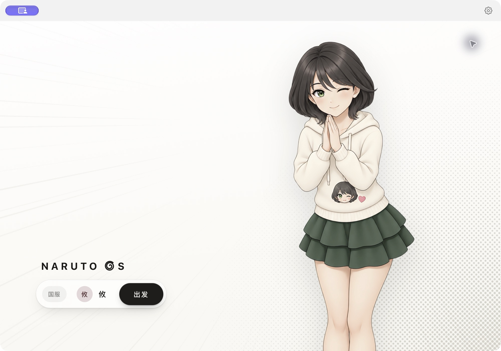

<p align="center">
  
</p>

<p align="center"><a href="README.md">简体中文</a> · <a href="README.en.md">English</a> · <a href="README.pt-BR.md">Português (Brasil)</a></p>

<h1 align="center">Naruto OS</h1>

<p align="center">A macOS launcher for Naruto Online, with support for the China and Brazil servers.</p>

<p align="center">
  <a href="https://github.com/qiuyuehu/NarutoOS/releases/latest"><strong>Download for macOS</strong></a> ·
  <a href="#download-and-installation">Installation</a> ·
  <a href="NarutoOS/docs/INSTALL.md#从源码运行">Run from source</a> ·
  <a href="https://github.com/qiuyuehu/NarutoOS/issues">Report an issue</a>
</p>



## Download and Installation

Download the latest `NarutoOS-*-macOS-AppleSilicon.zip` from [GitHub Releases](https://github.com/qiuyuehu/NarutoOS/releases). Unzip it and drag **Naruto OS.app** into Applications. Flash is included; you do not need to install Node.js or developer tools for normal use.

If you have GitHub CLI installed, you can download and open it from Terminal:

```sh
gh release download --repo qiuyuehu/NarutoOS --pattern 'NarutoOS-*-macOS-AppleSilicon.zip'
ditto -xk NarutoOS-*-macOS-AppleSilicon.zip .
open "Naruto OS.app"
```

An Apple Silicon Mac running macOS 15 or later is required. The game uses an Intel build of Electron and runs through Rosetta. Follow the system prompt if macOS asks you to install Rosetta.

The app is locally signed and has not been notarized by Apple. If macOS blocks it on first launch, confirm that the app came from this repository, then follow [Apple's instructions](https://support.apple.com/en-us/102445) to open it.

## Features

- **China and Brazil servers**: Choose a server in the launcher to get started.
- **Account profiles**: Each profile keeps its own login session and can include a server note. Sign in again if a session expires or you log out.
- **Multiple account tabs**: Keep frequently used accounts in one window and switch without signing in again. Audio plays only from the active tab.
- **Remembered graphics quality**: Choose low, medium, or high; the launcher remembers your last selection.
- **Flash versions**: Choose Flash 31 or 34. Restart the game for the change to take effect.
- **Brazil server localization**: Selected frequently used screens are translated into Chinese. Enable it in Settings.
- **Damo assist**: Complete one perfect strike sequence with one click, without repeating the manual clicks when rotating between accounts.
- **Ninjutsu Training assist**: Supports two activity variants. Each click completes one hand-seal sequence; run the three daily sequences separately.

## License and Disclaimer

Original launcher code is available under the [MIT License](LICENSE). Game assets, localization content, Damo assist files, and third-party runtime components are excluded from that license. See [Third-Party Notices](THIRD_PARTY_NOTICES.md) for details.

This project is provided for learning, discussion, and technical research. I am not authorized by the game or the owners of related components, and this project is not affiliated with them. Before using it, review the terms and rules for your server, especially those concerning assist features. I cannot guarantee that the operator permits these features or that an account will be free from anti-cheat measures, login restrictions, or suspension. The official website, game resources, network conditions, and macOS updates may affect operation, and login sessions may expire. The project is provided as-is, without a promise of ongoing updates or compatibility with every device. To the extent permitted by law, the author and contributors are not liable for account, progress, data, or other losses arising from use of the project; this does not exclude liability that cannot legally be waived.

---

Maintained by Youye. GPT / Codex contributed to implementation, debugging, and documentation.
