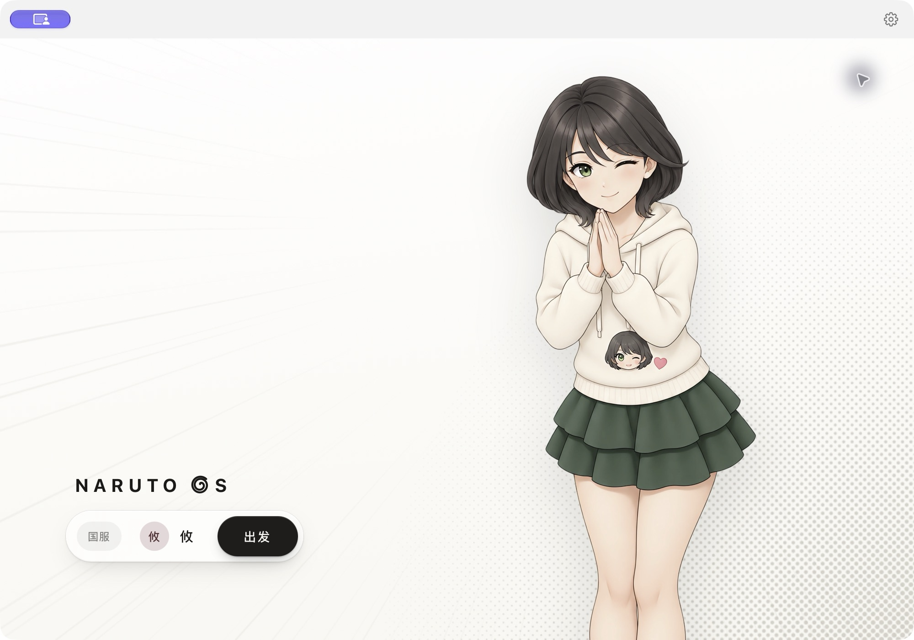
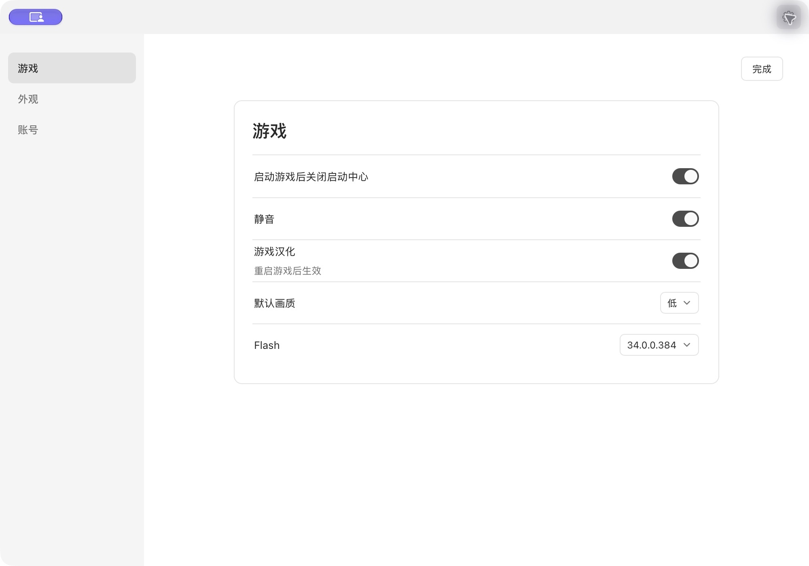

  

<h1 align="center">Naruto OS</h1>

我为 Mac 做了一个《火影忍者 Online》启动器，支持国服和巴西服。

<a href="README.md">简体中文</a> · <a href="README.en.md">English</a> · <a href="README.pt-BR.md">Português (Brasil)</a>

  <a href="https://github.com/qiuyuehu/NarutoOS/releases/latest"><strong>下载最新版本</strong></a> ·
  <a href="#安装与使用">安装说明</a> ·
  <a href="NarutoOS/README.md#运行">从源码运行</a> ·
  <a href="https://github.com/qiuyuehu/NarutoOS/issues">反馈问题</a>

## 下载

前往 **[GitHub Releases](https://github.com/qiuyuehu/NarutoOS/releases)**，在发布版本的 **Assets** 中下载 macOS 应用安装包。免费使用，应用包内置 Flash，日常使用无需安装 Node.js 或开发工具。

在苹果菜单的「关于本机」查看芯片，然后选择对应的 ZIP。

| Mac | 下载文件后缀 | 系统要求 |
|---|---|---|
| Apple Silicon（M 系列） | `-macOS-AppleSilicon.zip` | macOS 15 或更新版本，游戏通过 Rosetta 运行 |
| Intel | `-macOS-Intel-Test.zip` | 最低部署版本 macOS 12.0，面向 Monterey 的测试构建 |

从 0.3.14 开始，应用内更新会自动选择与当前安装版相同架构的包。使用 0.3.13 Intel 测试版的用户请先手动安装一次新版。

## 安装与使用

1. 下载应用包。ZIP 解压后，将 **Naruto OS.app** 拖入「应用程序」；若提供 DMG，打开后将应用拖入「应用程序」。
2. 打开 Naruto OS。Apple Silicon Mac 如提示安装 Rosetta，按系统提示完成安装。
3. 在主页选择国服或巴西服，新建账号档案，点击「出发」。
4. 在官网页面登录并选择服务器。以后使用同一档案打开，即可继续使用保存的登录状态；官网会话过期或主动注销后需要重新登录。

应用目前采用本地签名，未做 Apple 公证。首次打开遇到系统拦截时，请核对下载来源，并参照 [Apple 的应用打开说明](https://support.apple.com/zh-cn/102445)处理。

开发环境准备和源码运行见[开发说明](NarutoOS/README.md#运行)。

## 功能

- **国服与巴西服**：在同一个启动器中选择入口。
- **登录状态保留**：每个账号档案单独保存登录状态；下次打开该档案时可以继续使用，直到游戏会话过期或主动退出。
- **独立账号档案**：每个档案各自保存登录信息，账号之间互不影响，也可以填写区服备注。
- **多账号标签**：把常用账号放在同一个窗口，切换时不用反复登录。后台标签保持运行，声音只从当前标签播放。
- **画质选择与记忆**：低、中、高三档可选，启动器会记住上次的选择。
- **Flash 版本选择**：支持 Flash 31 / 34，切换后重新启动游戏生效。
- **巴西服部分汉化**：覆盖部分高频使用场景，在设置中开启。
- **达摩辅助**：一键完成一轮 6×6 次完美敲击；需要在多个账号间重复操作时，可以省去逐次点击。

查看游戏设置截图

## 常用操作

| 操作 | 快捷键 |
|---|---|
| 打开其他账号 | `⌘T` |
| 关闭当前标签 | `⌘W` |
| 切换标签 | `⌃Tab` / `⌃⇧Tab` |
| 返回主页 | `⇧⌘H` |
| 刷新 | `⌘R` |
| 总静音 | `⇧⌘M` |
| 打开设置 | `⌘,` |

切换到巴西服后，如果刷新了游戏页面，请等页面重新加载并确认可以正常操作，再点击「完成切换」。

## 反馈与开发

遇到问题，请在 [Issues](https://github.com/qiuyuehu/NarutoOS/issues) 中说明 macOS 版本、芯片型号、应用版本、所在地区和复现步骤。截图请遮住账号、邮箱和聊天等个人信息。

- [安装与源码运行](NarutoOS/README.md#运行)
- [开发说明与专项检查](NarutoOS/README.md)

源码位于 `NarutoOS/`。启动管理界面使用 Swift，Flash 游戏宿主使用 Intel Electron；Apple Silicon 上通过 Rosetta 执行。

## 开源协议

启动器原创源码采用 [MIT License](LICENSE)，允许修改、商用与再分发。游戏资源、图像与第三方运行组件的许可范围见[第三方说明](THIRD_PARTY_NOTICES.md)。

## 免责声明

本项目仅供学习、交流与技术研究参考。使用者应自行判断项目是否适用于自己的用途，并承担因使用本项目及其辅助功能而产生的相应后果。

Naruto OS 是个人维护的非官方启动器，未获腾讯、Oasis Games、万代南梦宫、Adobe、Apple 或其他相关权利人授权，也不代表这些公司。游戏名称、商标、画面和游戏内容仍归各自权利人所有；项目采用 MIT 许可的范围仅限本项目原创代码，不包含游戏资源或其他第三方组件。使用和分发这些内容时，仍须遵守各自的许可与规则。

请在使用前了解对应区服的用户协议和运营规则，尤其是辅助功能相关规定。项目无法保证辅助功能获运营方认可，也无法保证账号不会遇到风控、登录限制或封禁。官网、游戏资源、网络环境和 macOS 更新都可能影响功能；登录状态也会随官网会话过期。项目按现状提供，不保证始终可用、持续更新或适用于每台设备。使用前请备份重要资料。法律允许的范围内，作者与贡献者不对使用本项目造成的账号、进度、数据或其他损失承担责任；法律规定不得免除的责任不受此限。

如认为项目内容侵犯了具体权利，请通过 [Issues](https://github.com/qiuyuehu/NarutoOS/issues) 指出相关页面或文件，并附上权属说明，方便核实处理。
