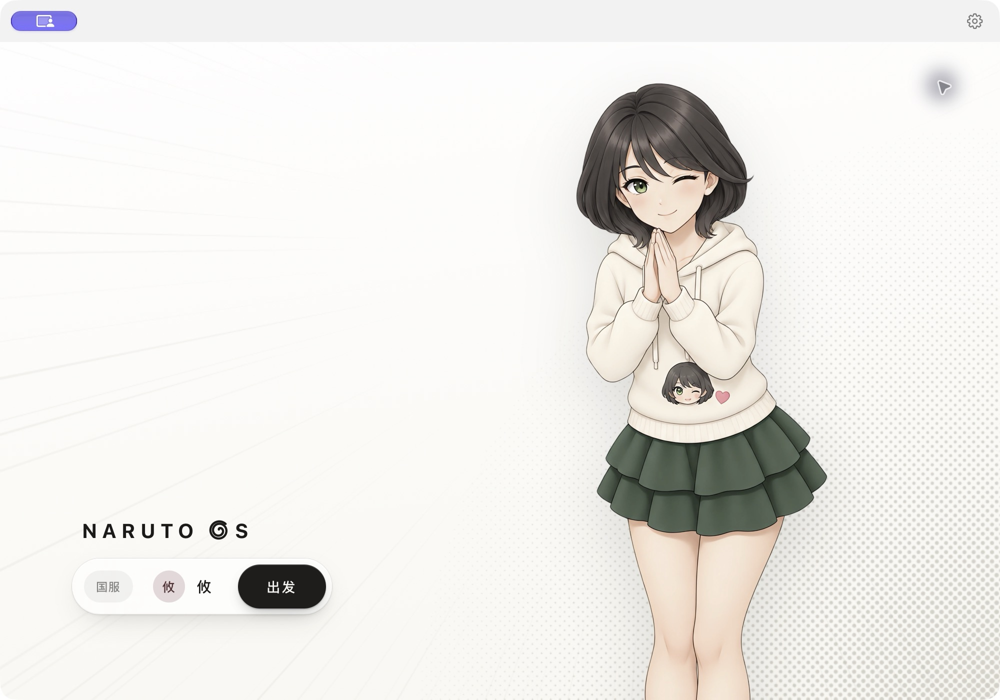

<p align="center">
  
</p>

<h1 align="center">Naruto OS</h1>

<p align="center">我为 Mac 做了一个《火影忍者 Online》启动器，支持国服和巴西服务器。</p>

<p align="center">
  <a href="https://github.com/qiuyuehu/NarutoOS/releases/latest"><strong>下载 macOS 版</strong></a> ·
  <a href="#下载与安装">安装说明</a> ·
  <a href="https://github.com/qiuyuehu/NarutoOS/issues">反馈问题</a>
</p>



## 下载与安装

在 [GitHub Releases](https://github.com/qiuyuehu/NarutoOS/releases) 下载最新的 `NarutoOS-*-macOS-AppleSilicon.zip`，解压后把 **Naruto OS.app** 拖进「应用程序」。安装包已经包含 Flash，普通使用不需要另装 Node.js 或开发工具。

装了 GitHub CLI 的话，也可以在终端下载并打开：

```sh
gh release download --repo qiuyuehu/NarutoOS --pattern 'NarutoOS-*-macOS-AppleSilicon.zip'
ditto -xk NarutoOS-*-macOS-AppleSilicon.zip .
open "Naruto OS.app"
```

需要 Apple Silicon Mac 和 macOS 15 或更新版本。游戏部分使用 Intel 版 Electron，通过 Rosetta 运行；系统提示安装 Rosetta 时，按提示操作即可。

应用使用本地签名，尚未经过 Apple 公证。首次打开若被 macOS 拦截，请先确认应用来自本仓库，再按 [Apple 的说明](https://support.apple.com/zh-cn/102445)打开。

## 功能

- **国服和巴西服**：在启动器里选择区服即可进入。
- **账号档案**：每个档案单独保存登录状态，也可以备注服务器。登录过期或主动退出后，重新登录即可。
- **多账号标签**：常用账号可以放在同一个窗口，切换时不用反复登录；声音只从当前标签播放。
- **画质记忆**：低、中、高三档可选，启动器会记住上次的选择。
- **Flash 版本**：可选 Flash 31 或 34，切换后重启游戏生效。
- **巴西服汉化**：部分常用界面已汉化，可在设置中开启。
- **达摩辅助**：一键完成一轮完美敲击；多账号轮流操作时，不必重复手动点击。

## 许可与说明

启动器原创代码采用 [MIT License](LICENSE)。游戏资源、汉化内容、达摩辅助文件和第三方运行组件不在这份许可范围内，详见[第三方说明](THIRD_PARTY_NOTICES.md)。

本项目仅供学习、交流与技术研究参考。我没有获得游戏或相关组件权利人的授权，项目也不代表他们。使用前请了解对应区服的用户协议和运营规则，尤其是辅助功能相关规定；我无法保证辅助功能获运营方认可，也无法保证账号不会遇到风控、登录限制或封禁。官网、游戏资源、网络环境和 macOS 更新都可能影响使用，登录状态也可能过期。项目按现状提供，不承诺持续更新或适配所有设备。法律允许的范围内，作者与贡献者不承担因使用本项目造成的账号、进度、数据或其他损失；法律规定不得免除的责任除外。

---

由攸也维护，GPT / Codex 参与了代码实现、调试和文档整理。
