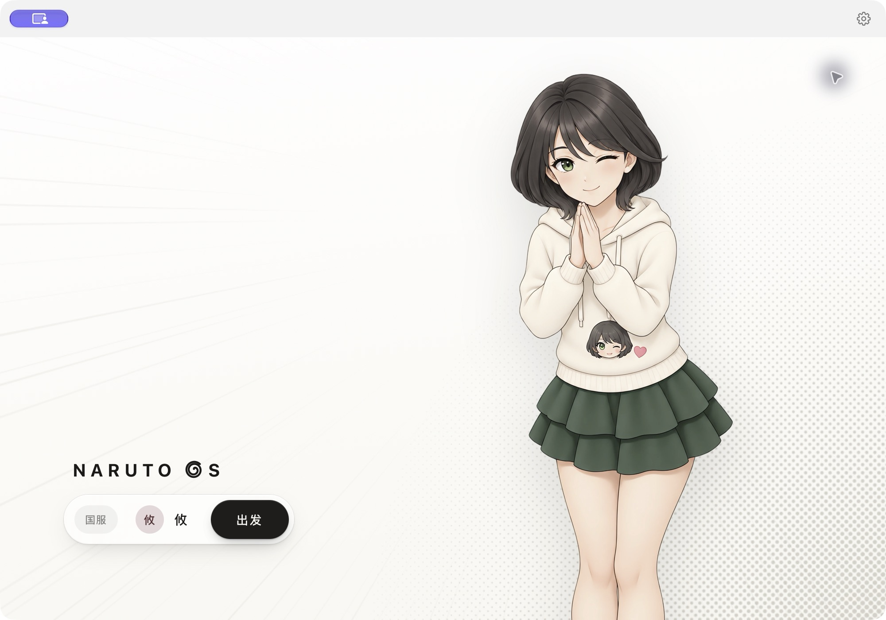

<p align="center">
  
</p>

<p align="center"><a href="README.md">简体中文</a> · <a href="README.en.md">English</a> · <a href="README.pt-BR.md">Português (Brasil)</a></p>

<h1 align="center">Naruto OS</h1>

<p align="center">Criei um launcher para Naruto Online no macOS, com suporte aos servidores da China e do Brasil.</p>

<p align="center">
  <a href="https://github.com/qiuyuehu/NarutoOS/releases/latest"><strong>Baixar para macOS</strong></a> ·
  <a href="#download-e-instalação">Instalação</a> ·
  <a href="NarutoOS/docs/INSTALL.md#从源码运行">Executar a partir do código</a> ·
  <a href="https://github.com/qiuyuehu/NarutoOS/issues">Relatar um problema</a>
</p>



## Download e instalação

Baixe o arquivo mais recente `NarutoOS-*-macOS-AppleSilicon.zip` em [GitHub Releases](https://github.com/qiuyuehu/NarutoOS/releases). Descompacte-o e arraste **Naruto OS.app** para a pasta Aplicativos. O Flash já está incluído; para usar o app normalmente, não é necessário instalar Node.js nem ferramentas de desenvolvimento.

Se você tiver o GitHub CLI instalado, também pode baixar e abrir o app pelo Terminal:

```sh
gh release download --repo qiuyuehu/NarutoOS --pattern 'NarutoOS-*-macOS-AppleSilicon.zip'
ditto -xk NarutoOS-*-macOS-AppleSilicon.zip .
open "Naruto OS.app"
```

É necessário ter um Mac com Apple Silicon e macOS 15 ou posterior. O jogo usa uma versão do Electron para Intel e roda por meio do Rosetta. Se o macOS pedir para instalar o Rosetta, siga as instruções na tela.

O app é assinado localmente, mas ainda não passou pela notarização da Apple. Se o macOS bloquear a primeira abertura, confirme que o app veio deste repositório e siga as [instruções da Apple](https://support.apple.com/pt-br/102445) para abri-lo.

## Recursos

- **Servidores da China e do Brasil**: escolha o servidor no launcher para começar.
- **Perfis de conta**: cada perfil mantém sua própria sessão de login e pode incluir uma observação sobre o servidor. Se a sessão expirar ou você sair da conta, basta fazer login novamente.
- **Várias abas de conta**: mantenha as contas que usa com frequência na mesma janela e alterne entre elas sem fazer login de novo. O áudio é reproduzido somente na aba ativa.
- **Qualidade gráfica memorizada**: escolha entre baixa, média e alta; o launcher guarda a última opção selecionada.
- **Versões do Flash**: escolha o Flash 31 ou 34. Reinicie o jogo para aplicar a alteração.
- **Tradução para o servidor do Brasil**: algumas telas usadas com frequência estão traduzidas para chinês. Ative a opção em Ajustes.
- **Assistente do Damo**: conclua uma sequência perfeita de golpes com um clique, sem repetir os cliques manuais ao alternar entre contas.
- **Assistente de Treinamento de Ninjutsu**: compatível com duas variantes da atividade. Cada clique conclui uma sequência de selos manuais; execute separadamente as três sequências diárias.

## Licença e aviso

O código original do launcher está disponível sob a [Licença MIT](LICENSE). Os recursos do jogo, o conteúdo de tradução, os arquivos do assistente do Damo e os componentes de terceiros usados em tempo de execução não estão incluídos nessa licença. Consulte os [Avisos de terceiros](THIRD_PARTY_NOTICES.md) para obter mais detalhes.

Este projeto é fornecido para fins de aprendizado, troca de conhecimento e pesquisa técnica. Não tenho autorização da empresa responsável pelo jogo nem dos titulares dos direitos dos componentes relacionados, e o projeto não é afiliado a eles. Antes de usar, consulte os termos de uso e as regras do seu servidor, especialmente as regras sobre recursos auxiliares. Não posso garantir que a empresa responsável pelo jogo permita esses recursos nem que uma conta esteja livre de medidas antitrapaça, restrições de login ou suspensão. O site oficial, os recursos do jogo, as condições de rede e as atualizações do macOS podem afetar o funcionamento, e as sessões de login podem expirar. O projeto é fornecido no estado atual, sem promessa de atualizações contínuas ou compatibilidade com todos os dispositivos. Na medida permitida por lei, o autor e os colaboradores não se responsabilizam por perdas de conta, progresso, dados ou outros prejuízos decorrentes do uso deste projeto; isso não exclui responsabilidades que não possam ser legalmente afastadas.

---

Mantido por Youye. GPT / Codex contribuíram com a implementação do código, a depuração e a organização da documentação.
